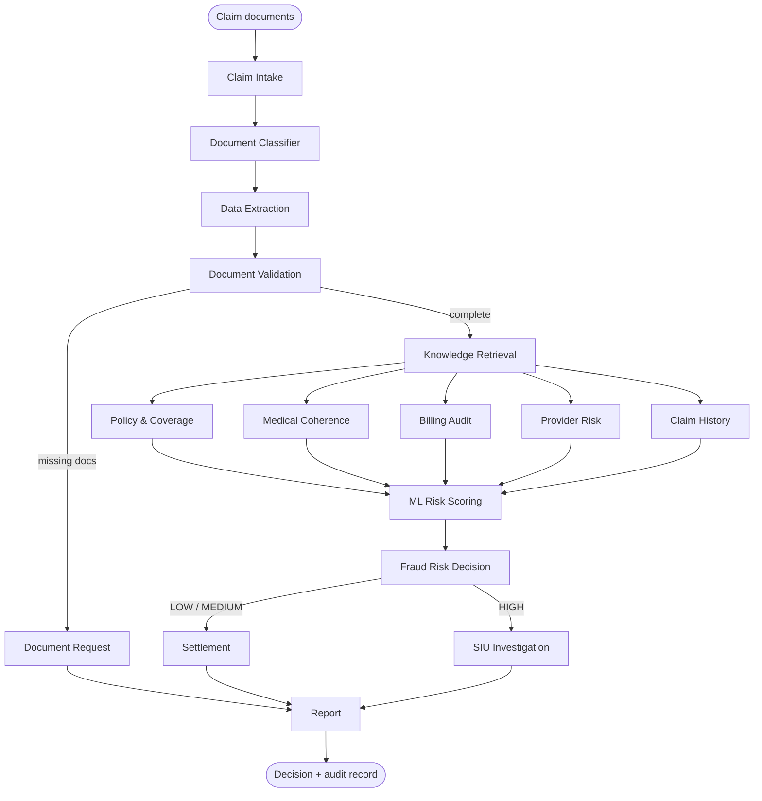

# ClaimGuard AI

**An agentic AI system that processes medical insurance claims, validates the claim documents and detects fraud.**

Upload a claim (claim form, hospital bill, discharge summary). Sixteen agents, orchestrated as a **LangGraph `StateGraph`**, read the documents, check them against the policy, the provider registry, clinical benchmarks and claim history, compute an explainable **fraud score (0-100)**, and route the claim to *auto-approve*, *human review*, *SIU investigation*, *not admissible* or *documents pending*.

| | |
|---|---|
| Domain | Health / medical insurance (India, ₹, IRDAI waiting-period rules) |
| Agent framework | **LangGraph** (`StateGraph`, parallel fan-out, join, conditional edges). A zero-dependency built-in engine runs the same graph if LangGraph is unavailable |
| Intelligence | Rule engine (9 industry fraud categories, 40+ explainable checks), scikit-learn Gradient Boosting + Isolation Forest, PDF forensics |
| App | FastAPI REST API + web UI, SQLite audit trail, CLI |
| **Not used** | LangChain (no imports), Groq, Grok, OpenAI, GPT, LLaMA, HuggingFace, any vector DB (Pinecone, Chroma, FAISS), Redis |

> **About LangChain:** the project never imports LangChain. Note that `pip install langgraph` pulls in `langchain-core` as a *transitive* dependency of LangGraph. If your reviewer requires *zero* LangChain packages installed, set `CLAIMGUARD_ENGINE=builtin` and remove `langgraph` from `requirements.txt`. The identical graph then runs on `app/mini_graph.py`, and the test suite checks both engines give identical results.

---

## 1. Quick start (5 minutes)

```bash
# Python 3.11+ recommended
python -m venv .venv
source .venv/bin/activate            # Windows: .venv\Scripts\activate
pip install -r requirements.txt

python -m app.cli showcase           # runs all 7 sample claims -> outputs/
uvicorn app.api:app --reload         # open http://127.0.0.1:8000  (API docs: /docs)
```

Or simply `./run.sh` (macOS/Linux) / `run.bat` (Windows).

Other commands:

```bash
python -m app.cli run data/sample_claims/CLM-2026-1004          # one claim folder
python -m app.cli run claim_form.pdf hospital_bill.pdf discharge_summary.pdf --json result.json
python -m app.cli run examples/json_claim                        # structured JSON input
python -m app.cli train                                          # retrain the ML model
python -m app.cli samples                                        # regenerate sample PDFs
python -m app.cli graph                                          # print workflow (Mermaid)
pytest -q                                                        # 26 tests
```

## 2. Showcase: inputs ready, outputs ready

Inputs live in `data/sample_claims/<CLAIM-ID>/` (realistic PDFs: claim form, hospital bill, discharge summary, prescription). Outputs were produced by running the pipeline once and are stored in `outputs/`:

| Claim | Scenario (input) | Fraud score | Decision | Net payable |
|---|---|---:|---|---:|
| CLM-2026-1001 | Genuine: dengue at a network hospital | 1 | AUTO_APPROVE | ₹37,950 |
| CLM-2026-1002 | Genuine: appendectomy, room above policy cap | 1 | AUTO_APPROVE | ₹67,200 (proportionate deduction) |
| CLM-2026-1003 | Typhoid, long stay, repeat claimant, hospital with a claims spike | 49 | HUMAN_REVIEW | ₹49,995 (provisional) |
| CLM-2026-1004 | Fever billed ₹1.2 lakh with MRI/CT/endoscopy, Photoshop-edited bill, 25-day-old policy | 98 | SIU_INVESTIGATION | on hold |
| CLM-2026-1005 | Angioplasty 8 months after inception, undeclared diabetes and hypertension | 33 | HUMAN_REVIEW | ₹3,61,900 (provisional) |
| CLM-2026-1006 | Accident fracture, discharge summary missing, unsigned bill | – | PENDING_DOCUMENTS | – |
| CLM-2026-1007 | Same hospital bill already settled by another insurer | 74 | SIU_INVESTIGATION | on hold |

* `outputs/SHOWCASE.md`: every input and output side by side
* `outputs/showcase.html`: the full web UI with all results embedded. It opens offline by double-click and can be hosted as a static page (GitHub Pages)
* `outputs/<CLAIM-ID>/output.txt | result.json | report.html`: per-claim output

Example output (CLM-2026-1004):

```text
Fraud Score: 98 (High Risk)
Suspicious Reasons:
- Possible document tampering in hospital_bill.pdf: PDF produced/edited with image-editing software ('photoshop'); PDF modified 5 day(s) after creation
- Bill does not tally: grand total ₹1,20,000 but line items add up to ₹1,23,300
- Total bill ₹1,20,000 is 4.9x the typical maximum ₹24,500 for viral fever at a small clinic
- Treatment does not match diagnosis: MRI Brain (plain), CT Scan Chest, Upper GI Endoscopy (₹40,400) not clinically indicated for viral fever
- Hospitalised only 25 days after buying the policy (initial 30-day waiting period)
- Shree Sai Clinic & Nursing Home is on the fraud watchlist ...
Triggered Categories:
- Document Issues
- Hospital Pattern Risk
- Treatment Duration Abnormality
- Bill Amount
- Single Item Charge
- Diagnosis Mismatch
- Suspicious Timing (new policy)
- Room Rent / Procedure Overcharging
Decision: SIU INVESTIGATION
```

## 3. Architecture



| # | Agent (node) | Responsibility |
|---|---|---|
| 1 | Claim Intake (`intake`) | Registers claim, assigns run id, collects files |
| 2 | Document Classifier (`classify`) | Reads PDF/TXT/JSON/image, identifies claim form / bill / discharge summary / prescription; captures PDF metadata |
| 3 | Data Extraction (`extract`) | Regex/label extraction of 30+ fields and bill line items into one consolidated claim |
| 4 | Document Validation (`validate`) | Completeness, bill arithmetic, seals, doctor reg. no, cross-document name/date consistency, **PDF forensics** |
| 5 | Document Request (`request_docs`) | Pauses incomplete claims and drafts the deficiency letter |
| 6 | Knowledge Retrieval (`knowledge`) | Policy & member, provider registry, clinical KB (ICD-10), claim history, industry registry |
| 7-11 | **Parallel analysts**: Policy & Coverage, Medical Coherence, Billing Audit, Provider Risk, Claim History | Each owns fraud categories, emits explainable findings + ML features |
| 12 | ML Risk Scoring (`ml_scoring`) | Join node: Gradient Boosting probability + Isolation Forest anomaly + top drivers |
| 13 | Fraud Risk Decision (`decision`) | Fuses rules + ML into the 0-100 score, band, status, recommendation |
| 14 | Settlement (`settlement`) | Non-payables, room-rent proportionate deduction, ICU cap, co-pay, sum insured |
| 15 | SIU Investigation (`siu`) | Prioritised investigation plan, evidence pack, payment hold |
| 16 | Report (`report`) | Output text, narrative, printable report, SQLite audit record |

### Fraud score

```
rule_score  = noisy-OR over categories     (inside a category: 1st finding full weight, 2nd half, 3rd quarter...)
ml_score    = 100 x P(fraud) from GradientBoostingClassifier (19 features)
fraud_score = 0.55 x rule_score + 0.45 x ml_score
              raised to >= 70 if any CRITICAL finding (tampered document, duplicate bill, blacklisted hospital, unknown policy/member)

< 30   LOW     Genuine           -> AUTO_APPROVE (or NOT_ADMISSIBLE if policy terms exclude it)
30-65  MEDIUM  Suspicious        -> HUMAN_REVIEW (provisional settlement computed)
> 65   HIGH    High fraud risk   -> SIU_INVESTIGATION (payment on hold)
```

All thresholds and weights are configurable in `.env` (see `.env.example`).

### The 9 fraud categories

Bill Amount, Single Item Charge, Diagnosis Mismatch, Hospital Pattern Risk, Patient Claim History, Document Issues, Treatment Duration Abnormality, Room Rent / Procedure Overcharging, Suspicious Timing (new policy). The full rule catalogue is in `docs/REQUIREMENTS.md`.

### ML model

Gradient Boosting (250 trees, depth 3) trained on 8,000 historical claims generated from four behavioural profiles (genuine, bill inflation, phantom treatment, misrepresentation) with overlapping distributions and label noise. On the held-out 20%: **ROC-AUC 0.92, PR-AUC 0.82, precision 0.89, recall 0.78**. The dataset is synthetic. Replace `data/training/historical_claims.csv` with real labelled claims and run `python -m app.cli train`. The model also retrains itself automatically if the saved artifact was built with a different scikit-learn version.

## 4. Project structure

```
ClaimGuard-AI/
├── app/
│   ├── graph.py              # LangGraph workflow (nodes, fan-out, join, conditional edges)
│   ├── mini_graph.py         # built-in StateGraph engine (same API, no dependencies)
│   ├── state.py              # shared ClaimState with reducers
│   ├── agents/               # 16 agents
│   ├── tools/                # document reader, extractor, knowledge-base lookups, utils
│   ├── knowledge/            # JSON knowledge bases (medical, tariffs, hospitals, policies, history)
│   ├── ml/model.py           # dataset, training, inference (+ artifacts/)
│   ├── llm/narrator.py       # case-note writer (template; optional Claude)
│   ├── api.py                # FastAPI app
│   ├── web/                  # UI (index.html, static/app.js, static/styles.css)
│   ├── db.py                 # SQLite audit trail
│   ├── report_html.py        # printable report
│   ├── showcase.py           # batch-run samples -> outputs/
│   └── cli.py
├── data/sample_claims/       # 7 input claim packages (PDF)
├── data/training/            # historical claims CSV for the ML model
├── examples/json_claim/      # structured JSON input example
├── outputs/                  # precomputed outputs + showcase.html
├── docs/                     # REQUIREMENTS.md, ARCHITECTURE.md, DEPLOYMENT.md
├── scripts/generate_sample_claims.py
├── tests/                    # pytest (26 tests)
├── Dockerfile, render.yaml, Procfile, run.sh, run.bat
└── requirements.txt
```

## 5. Hosting the live application

See `docs/DEPLOYMENT.md`. In short: push to GitHub, then on **Render** choose *New > Blueprint* and select the repo (`render.yaml` deploys the Docker image on the free plan). Your app is live at `https://claimguard-ai.onrender.com` (or similar). The static showcase (`outputs/showcase.html`) can also be published on GitHub Pages.

## 6. REST API

| Method | Path | Purpose |
|---|---|---|
| GET | `/api/health` | Liveness + engine in use |
| GET | `/api/samples` | Sample claim packages |
| POST | `/api/samples/{claim_id}/run` | Run the agents on a sample |
| POST | `/api/claims/upload` | Multipart upload (1-10 files: PDF/TXT/JSON/PNG/JPG) -> full decision |
| GET | `/api/claims` | Claims register (audit DB) |
| GET | `/api/claims/{run_id}` | Full decision record |
| GET | `/api/claims/{run_id}/report` | Printable HTML report |
| GET | `/api/workflow` | Agents, categories, Mermaid graph |
| GET | `/api/model` | ML metrics & feature importance |

Interactive docs: `/docs` (Swagger UI).

## 7. Optional extras

* **LLM case note:** `pip install anthropic`, set `LLM_PROVIDER=anthropic` and `ANTHROPIC_API_KEY`. Claude only rewrites the investigator note from the structured findings. It never changes the score or the decision. Default: deterministic template, fully offline.
* **OCR for scanned images:** `pip install pytesseract Pillow` + install the Tesseract binary.

## 8. Data disclaimer

All people, hospitals, policies and claims in this repository are **fictional** and every sample PDF is marked as synthetic. Waiting-period rules follow IRDAI norms (30-day initial waiting period, pre-existing disease waiting period capped at 36 months). Cost and tariff benchmarks are indicative demo values. Calibrate them with real insurer data before any production use.
